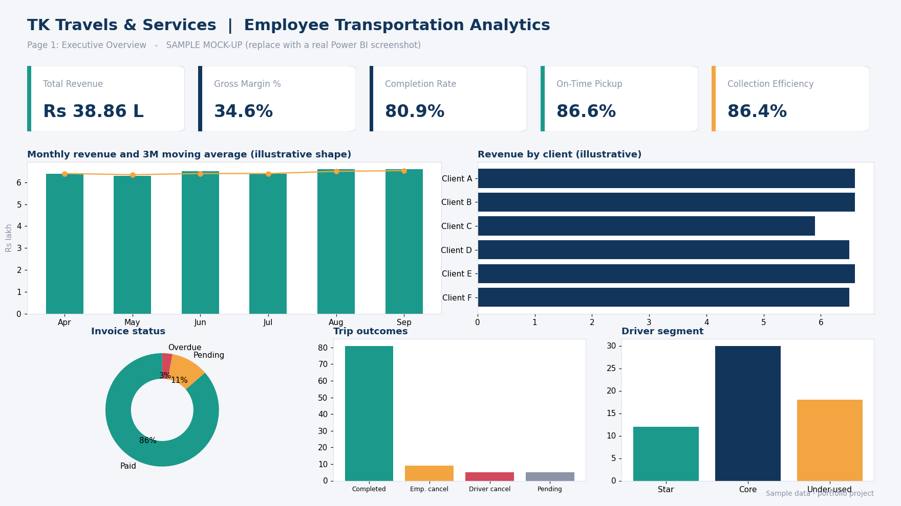

# Employee Transportation Analytics | Power BI

*Illustrative mock-up. A screenshot of the final report will replace this image.*

## Project Overview

This project analyses employee transportation operations for a fictional cab-supply company serving tech-park clients. It covers financial performance, roster operations, driver payments, service exceptions, driver complaints and employee feedback, and it includes a dry-run WhatsApp automation concept for complaints, EMI statements and payment reminders.

The project uses **synthetic sample data** covering April to September 2026. It is built for demonstration, analytical practice and portfolio development. It does not describe real company performance.

## Business Objectives

- Analyse company invoicing, collections and outstanding amounts.
- Evaluate transportation operations and roster performance.
- Analyse driver payments, EMI deductions and completed trips.
- Identify operational exceptions and driver complaints.
- Understand employee feedback and service quality.
- Compare salary-based and revenue-share driver cost models.
- Build a data model that supports reporting and decision-making.

## Tools & Technologies

Microsoft Power BI, Power Query, DAX, Microsoft Excel, Google Sheets (automation demo), Python (dry-run script), GitHub.

## Repository Structure

| Folder | Contents |
|---|---|
| `data/` | Synthetic sample dataset (Excel / CSV) |
| `powerbi/` | Report preview images, data model screenshot, measure documentation, `.pbix` file |
| `automation/` | WhatsApp automation concept: rules, message templates, sample data, dry-run script |
| `documentation/` | Business requirements, data quality checks, KPI definitions |

## Dataset

| Table | Rows |
|---|---:|
| Clients | 6 |
| Employees | 240 |
| Drivers | 60 |
| Vehicles | 40 |
| Routes | 20 |
| RateCard | 4 |
| Rosters | 3,686 |
| EmployeeAssignments | 18,427 |
| CompanyInvoices | 36 |
| DriverPayments | 3,199 |
| DriverComplaints | 100 |
| EmployeeFeedback | 180 |
| Exceptions | 597 |

Working financial assumptions:

- Company revenue is calculated per chargeable roster (completed trips plus employee cancellations).
- Driver payout is calculated per completed roster.

## Data Model

- `Rosters` is the central fact table, linked to Drivers, Clients, Routes and Vehicles.
- A dedicated `Calendar` table (calendar year plus Indian fiscal year, April to March) is marked as the date table and linked to rosters, payments, complaints, feedback, exceptions and invoices.
- `EmployeeAssignments` links to both Rosters and Employees.
- Invoice billing, due and paid dates use inactive relationships activated with `USERELATIONSHIP`.

## DAX Measures

Around 80 documented measures sit in a dedicated measure table, grouped into display folders: Core KPIs, Receivables, Driver Economics (including Salary vs Share), Service Quality, Time Intelligence, Advanced Analytics and Helpers. Each measure carries purpose notes and links to Microsoft documentation inside the DAX code. Calculated columns are documented the same way.

Because the data covers six months, month-over-month measures are the working comparison. Year-over-year measures return blank until a second year of data exists.

## Headline Results (sample data)

| KPI | Value |
|---|---:|
| Total revenue | Rs 38.86 lakh |
| Gross margin | 34.6% |
| Roster completion rate | 80.9% |
| On-time pickup | 86.6% |
| Collection efficiency | 86.4% |

Early findings suggest that driver utilisation is low (about 8 completed trips per driver per month), which makes revenue share safer than salary at current volumes, and that most outstanding receivables sit with one tech park.

## Project Status

**Current stage:** Data model complete; measures and calculated columns documented; report pages in progress.

- [x] Data cleaning and modelling
- [x] Calendar table and relationships
- [x] KPI, time intelligence and advanced DAX measures
- [ ] Three-page report (Executive Overview, Operations and Drivers, Receivables and Risk)
- [ ] Slicers and metric toggle
- [ ] Incremental refresh documentation
- [ ] Automation dry-run demo

## Planned Report Pages

1. Executive Overview: revenue, margin, collections, trend and client mix.
2. Operations and Drivers: trips, punctuality, complaints, driver segments, salary vs share.
3. Receivables and Risk: ageing, outstanding by tech park, EMI coverage.

## Automation Concept

See [`automation/`](automation/) for four dry-run WhatsApp flows: complaint to driver, driver complaint to agency manager, monthly EMI statement, and formal payment request. Messages are written to a log file by default. No real messages are sent and no real contact details are used.

## Data Privacy

Published datasets must use synthetic records, fictional names and fictional contact details. No confidential company records or personal information should be committed. Secrets such as API tokens belong in a local `.env` file, which is excluded by `.gitignore`.

## Disclaimer

This is a portfolio analytics project using synthetic sample data. The data and resulting analysis are for demonstration purposes and should not be interpreted as actual company performance or verified business results.
